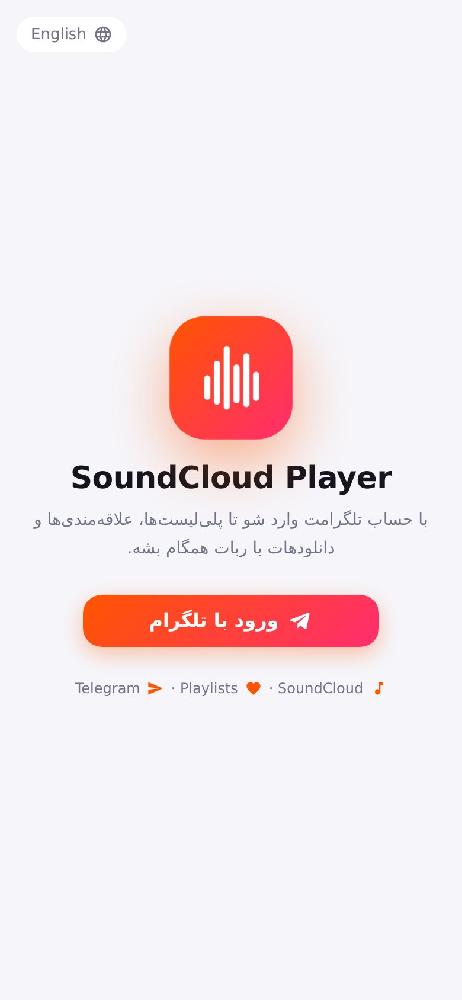
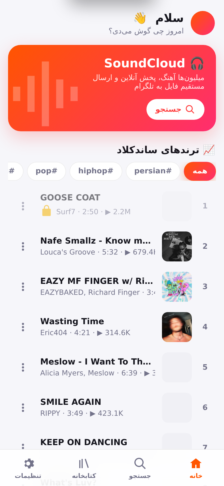
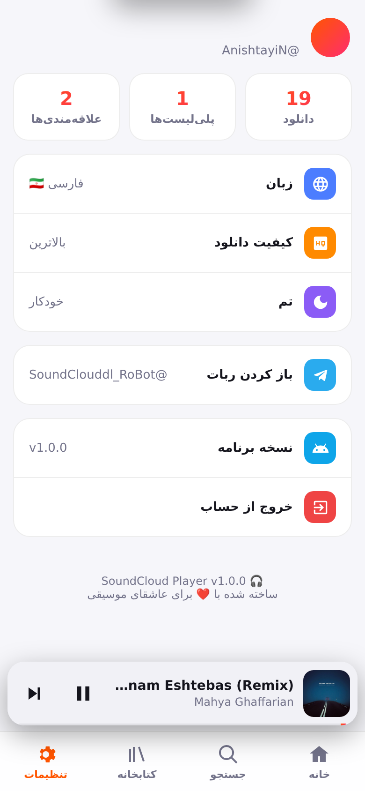

<div align="center">


# SoundCloud Player — Android & Windows

اپ‌های رسمی ربات **[@SoundClouddl_RoBot](https://t.me/SoundClouddl_RoBot)** — دقیقاً همون ظاهر و امکانات مینی‌اپ تلگرام، به‌صورت برنامه‌ی مستقل.

[](https://github.com/AnishtayiN/soundcloud-player/actions/workflows/build.yml)

**[⬇️ دانلود اندروید (APK)](https://github.com/AnishtayiN/soundcloud-player/releases/latest/download/SoundCloud-Player.apk)** &nbsp;·&nbsp;
**[⬇️ دانلود ویندوز (EXE)](https://github.com/AnishtayiN/soundcloud-player/releases/latest/download/SoundCloud-Player-Setup.exe)** &nbsp;·&nbsp;
[همه‌ی نسخه‌ها](https://github.com/AnishtayiN/soundcloud-player/releases)

  
</div>

## امکانات
- 🔎 جستجوی ترک، آرتیست و پلی‌لیست ساندکلاد · ژانرها و ترندها
- ▶️ پخش آنلاین با صف پخش، شافل، تکرار، seek
- 📂 ساخت و مدیریت پلی‌لیست · ❤️ علاقه‌مندی‌ها · 🕘 تاریخچه — **همگام با ربات و مینی‌اپ**
- 📤 «ارسال به چت»: فایل صوتی رو مستقیم توی تلگرامت بگیر
- 🔐 ورود امن با تلگرام (بدون رمز): برنامه یه لینک/QR می‌سازه ← توی ربات «تایید ورود» رو می‌زنی
- 🌗 تم روشن/تاریک/خودکار · 🇮🇷/🇬🇧 فارسی و انگلیسی
- 🔔 **اندروید:** پخش در پس‌زمینه + نوتیفیکیشن پلیر (کنترل از صفحه‌قفل و هدفون)
- ⌨️ **ویندوز:** کلیدهای مدیا کیبورد و کنترل پخش ویندوز ۱۰/۱۱
- ⬆️ اطلاع‌رسانی خودکار نسخه‌ی جدید

## سازگاری
| پلتفرم | حداقل | حداکثر |
|---|---|---|
| Android | 7.0 (API 24) | آخرین نسخه (target API 35) |
| Windows | 7 SP1 (32/64-bit) | 11 |

ویندوز با **Electron 22** ساخته می‌شه (آخرین نسخه‌ای که ویندوز ۷/۸/۸.۱ رو پشتیبانی می‌کنه). نصب‌کننده‌ی NSIS هر دو معماری x86 و x64 رو داره.

## ساختار
```
web/        رابط کاربری مشترک (همون مینی‌اپ، ترنسپایل‌شده برای WebViewهای قدیمی‌تر)
android/    پروژه‌ی اندروید (Java · WebView + MediaSession + Foreground Service)
desktop/    پروژه‌ی ویندوز (Electron 22 + electron-builder/NSIS)
.github/workflows/build.yml   ساخت APK و EXE و انتشار در Releases
```

## ساخت نسخه‌ی جدید
- **روش ۱:** Actions ← *Build & Release (APK + EXE)* ← **Run workflow** ← شماره‌ی نسخه (مثلاً `1.0.1`)
- **روش ۲:** `git tag v1.0.1 && git push origin v1.0.1`

حدوداً ۵ تا ۸ دقیقه بعد، `SoundCloud-Player.apk` و `SoundCloud-Player-Setup.exe` توی Releases منتشر می‌شن و لینک‌های «latest» (که توی ربات هستن) خودکار به نسخه‌ی جدید اشاره می‌کنن. برنامه‌ها هم به کاربر اطلاع می‌دن.

### Secrets (برای امضای APK)
| نام | توضیح |
|---|---|
| `ANDROID_KEYSTORE_B64` | فایل keystore (PKCS12) به‌صورت base64 |
| `ANDROID_KEYSTORE_PASSWORD` | رمز keystore و کلید |
| `ANDROID_KEY_ALIAS` | alias کلید |

> ⚠️ keystore رو عوض نکن؛ وگرنه آپدیت روی نسخه‌ی قبلی نصب نمی‌شه (باید اول حذف بشه).

## اجرای محلی
```bash
# ویندوز / دسکتاپ
cp -r web desktop/web && cd desktop && npm install && npm start
# اندروید
mkdir -p android/app/src/main/assets/www && cp -r web/* android/app/src/main/assets/www/
cd android && gradle assembleDebug
```

## نکات
- نصب‌کننده‌ی ویندوز امضای دیجیتال (code signing) نداره، پس SmartScreen ممکنه هشدار بده ← **More info ← Run anyway**.
- اندروید: اجازه‌ی «نصب برنامه‌های ناشناس» رو برای مرورگر/تلگرام فعال کن.
- روی Android 7 اگه ظاهر به‌هم‌ریخته بود، **Android System WebView** رو از Play Store آپدیت کن.

---
**EN:** Native Android & Windows clients for the SoundCloud Telegram bot, sharing the Mini App UI. Push a `v*` tag (or run the workflow manually) to build a signed APK (Android 7+) and an NSIS installer (Windows 7–11, x86+x64) and publish them to Releases.
